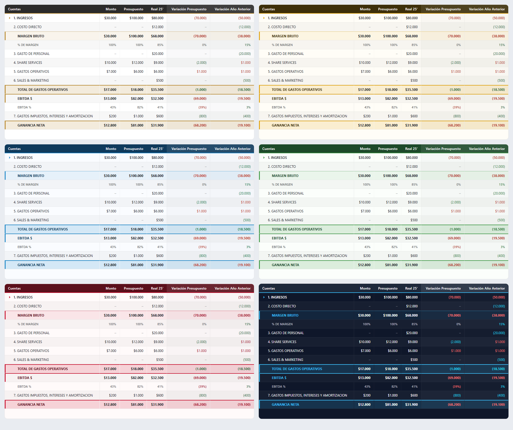
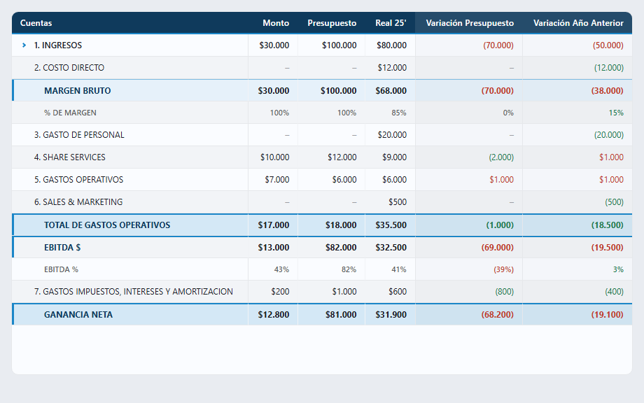
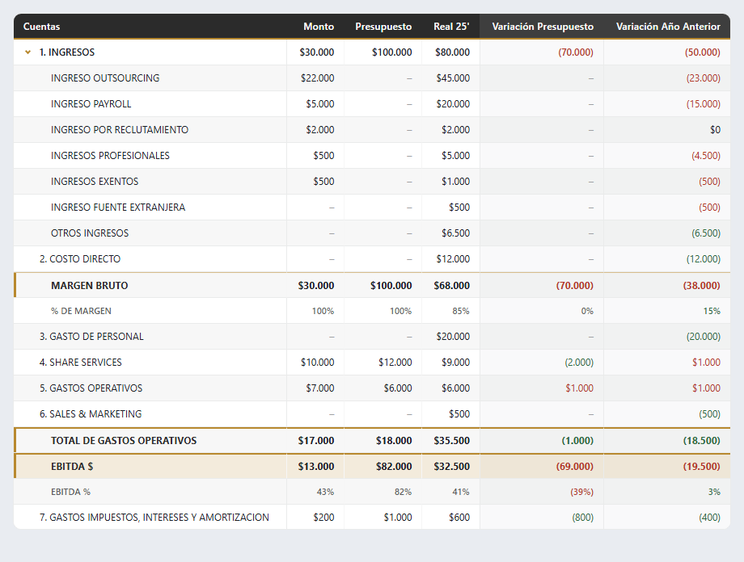
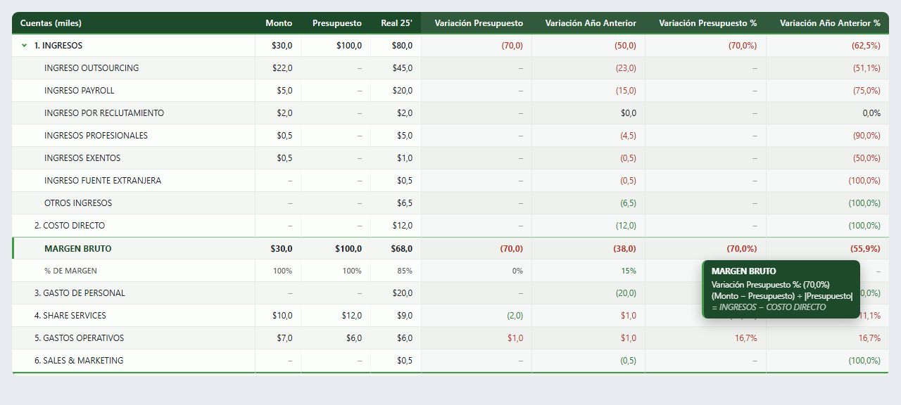

# Estado de Resultados para Power BI — visual personalizado

**Un visual propio de Power BI que presenta el Estado de Resultados de un grupo empresarial: calcula
márgenes, EBITDA y variaciones por sí mismo, sigue siendo útil con datos incompletos a mitad de mes y
adopta la identidad visual de cada empresa con un solo paquete.**



> Proyecto de uso interno desarrollado para un grupo empresarial. El código fuente es privado; este
> repositorio documenta el problema, la solución y las decisiones técnicas. Todas las cifras y capturas
> son **ficticias**.

---

## El problema

Un grupo de empresas consulta sus reportes financieros dentro de una plataforma propia, con
**Power BI Embedded**. El Estado de Resultados dependía de un **visual de terceros con licencia
adicional**, y presentaba tres dificultades:

1. **Costo y dependencia:** una licencia más por cada entorno, sobre un visual que no se podía modificar.
2. **Una identidad por empresa:** cada compañía del grupo necesitaba su color y su logo sobre el mismo reporte.
3. **Reportes que fallaban a mitad de mes.** Los gerentes consultan el reporte con frecuencia, también
   cuando el mes recién empieza y aún no se registran todos los costos. Con datos parciales, las filas
   de resultado (margen, EBITDA, ganancia neta) quedaban **vacías**, justo cuando más se quería ver
   "qué se está moviendo".

## La solución

Un **visual personalizado de Power BI** (TypeScript) que recibe la jerarquía de cuentas y las medidas que
ya existen en el modelo, y se encarga del resto.

### Qué hace

- **Calcula las filas de resultado** — margen bruto, % de margen, total de gastos operativos, EBITDA y
  ganancia neta — sin medidas adicionales en el modelo.
- **Funciona con datos incompletos.** Si falta un dato, cuenta como cero mientras haya al menos una cifra
  con la que calcular: a inicios de mes el margen y la ganancia **ya muestran un valor** y se ajustan a
  medida que entran los costos. Las cuentas sin movimiento siguen visibles, vacías, en su lugar.
- **Calcula las variaciones** contra presupuesto y contra el año anterior, en pesos y en porcentaje, y
  reconoce por sí mismo qué columna es cuál.
- **Colorea con criterio financiero:** en ingresos y resultados, bajar es rojo; en costos y gastos, bajar es verde.
- **Una identidad por empresa con un solo paquete.** Con tres colores deriva el resto de la paleta
  (tintes, líneas, filas alternas) y elige el color de texto por contraste, así cualquier marca queda legible.
- **Jerarquía expandible** que recuerda su estado al cambiar de pestaña.
- **Unidades** en pesos, miles o millones.



*Inicio de mes: aún no hay costo directo ni gasto de personal (guiones grises), y aun así el margen, el
EBITDA y la ganancia neta se calculan con lo registrado.*

### Detalle y explicaciones al pasar el cursor



Cada cifra tiene un cuadro explicativo con la **cifra exacta**, **cómo se calculó** una variación, la
**fórmula** de las filas de resultado y **por qué una celda está vacía**.



---

## Cómo funciona (visión general)

```text
Power BI entrega la matriz  →  se convierte en un árbol de cuentas  →  se completan las cuentas
(jerarquía + medidas)          (respetando celdas en blanco)           que no llegaron

→  se calculan las filas de resultado  →  se calculan las variaciones  →  se dibuja la tabla
   (con la regla de vacíos)               ($ y %, con su trazabilidad)     (tema + tooltips)
```

## Retos técnicos y decisiones

- **Vacíos que rompían los cálculos.** La resta devolvía "sin dato" si *cualquier* operando faltaba, y la
  suma sí toleraba vacíos: una inconsistencia que anulaba el margen y, en cascada, el EBITDA y la ganancia.
  Se definió una **regla única de vacíos** y se cubrió con pruebas automáticas.
- **Power BI omite las filas totalmente en blanco.** Si faltaba una cuenta, también faltaba la fila de
  resultado que dependía de ella. Las filas derivadas se crean **siempre** y las cuentas esperadas se
  completan, de modo que la estructura del reporte no cambia según el avance del mes.
- **Celdas en blanco que desplazaban columnas.** Un detalle de cómo Power BI entrega los valores
  (objetos dispersos indexados por columna) hacía que un hueco corriera los importes a la izquierda. Lo
  detecté montando el visual real con datos simulados fuera de Power BI.
- **Presupuesto definido solo por segmento.** El mismo importe se repetía en cada cuenta, y sumarlo lo
  multiplicaba. Una heurística automática rompía otros casos legítimos (dos facturas distintas con igual
  importe), así que la decisión fue **declarativa**: el usuario indica qué medidas son de segmento.
- **Identidad por empresa sin multiplicar paquetes.** En lugar de un paquete por empresa, el aspecto se
  deriva de tres colores en tiempo de ejecución; mantener un solo paquete simplifica versiones y despliegue.
- **Probar sin abrir Power BI.** La lógica de negocio vive en módulos puros con **pruebas automáticas** y
  construí una herramienta de **vista previa** que monta el visual real con datos simulados y toma capturas.
  Así los cambios de diseño y los casos límite se revisan en segundos.

## Tecnologías

TypeScript · Power BI Custom Visuals API · Power BI Embedded · CSS con variables y `color-mix()` ·
Pruebas con `node:test` · Git

## Resultados

- Se **elimina la dependencia y la licencia** del visual de terceros.
- **Un solo paquete** sirve a todas las empresas del grupo, cada una con su identidad.
- El reporte es **útil durante todo el mes**, incluso con datos parciales.
- Cobertura de **29 pruebas automáticas** sobre la lógica financiera, el formato de cifras y los temas.

## Aprendizajes

- Los casos límite de datos reales (vacíos, filas omitidas, estructuras dispersas) deben convertirse en
  **pruebas**, no solo en parches.
- Separar la lógica de negocio de la interfaz permite validarla rápido y con confianza.
- Documentar el **porqué** de cada decisión evita repetir los mismos errores.

---

## Contacto

**Jordan Díaz** · Analista de datos y desarrollo de soluciones

- LinkedIn: [linkedin.com/in/jordandiax](https://www.linkedin.com/in/jordandiax/)
- GitHub: [JordanDiaz07](https://github.com/JordanDiaz07)
- Teléfono: +507 63965192
